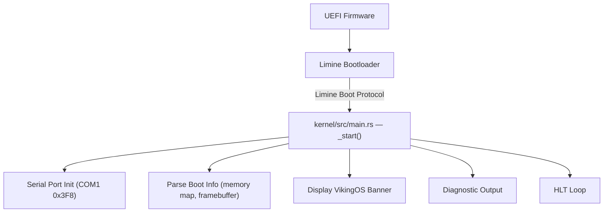
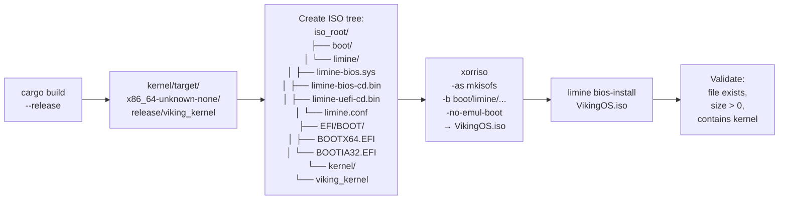

# VikingOS — Milestone 1 Architecture & Build Plan

## 1. Kernel Architecture



### Design Decisions

| Decision | Choice | Rationale |
|---|---|---|
| **Bootloader** | [Limine](https://github.com/limine-bootloader/limine) | Modern, well-documented, supports x86-64 UEFI+BIOS, Rust-friendly protocol via `limine` crate, no assembly stub needed |
| **Boot Protocol** | Limine Boot Protocol (revision 3) | Provides memory map, framebuffer, kernel address, RSDP — no manual multiboot header needed |
| **Target Triple** | `x86_64-unknown-none` | Rust's built-in bare-metal x86-64 target, no OS assumptions |
| **Language** | `no_std` Rust + `core` + `limine` crate | Safe, modern systems language; `limine` crate provides type-safe boot info |
| **Serial Output** | x86 I/O port 0x3F8 (COM1) | Universal QEMU/VMware serial console, no framebuffer driver needed initially |
| **Panic Handler** | Custom — prints to serial, then halts | Required by `no_std`; provides crash diagnostics |
| **ISO Tool** | `xorriso` + `limine` deploy tool | Standard El Torito ISO generation; Limine provides `limine bios-install` for BIOS boot |

## 2. Target & Linker Configuration

```
Target:         x86_64-unknown-none
Linker:         rust-lld (bundled with Rust)
Code Model:     kernel (addresses above 0xFFFFFFFF80000000)
Relocation:     static
Red Zone:       disabled (unsafe in kernel interrupt context)
Stack Probes:   disabled (no OS to handle guard pages)
SSE/AVX:        disabled (kernel must save/restore FPU state explicitly)
```

A custom linker script (`kernel/linker.ld`) will place:
- `.text` at the Limine-expected higher-half virtual address
- `.rodata`, `.data`, `.bss` in order
- A boot stack in `.bss`

## 3. Boot Protocol Flow

```
1. Firmware (UEFI or BIOS) loads Limine from ISO
2. Limine reads limine.conf, locates the kernel ELF
3. Limine sets up paging (higher-half direct map)
4. Limine passes control to kernel _start() with:
   - Memory map (physical regions, usable/reserved)
   - Framebuffer info (address, resolution, pitch)
   - HHDM offset (higher-half direct map base)
   - Boot time, RSDP pointer, SMP info
5. Kernel initializes serial console
6. Kernel prints boot banner and diagnostics
7. Kernel enters HLT loop
```

## 4. Memory Layout (Initial)

| Region | Virtual Address | Purpose |
|---|---|---|
| Kernel `.text` | `0xFFFFFFFF80000000+` | Kernel code (higher-half) |
| Kernel `.rodata` | After `.text` | Read-only data |
| Kernel `.data` | After `.rodata` | Initialized data |
| Kernel `.bss` | After `.data` | Zero-initialized data + boot stack |
| HHDM | `0xFFFF800000000000+` | Limine's higher-half direct map of all physical memory |
| Framebuffer | Mapped by Limine | Linear framebuffer for future graphics |

## 5. Repository Structure (Milestone 1)

```
VikingOS/
├── kernel/
│   ├── Cargo.toml          # Kernel crate, no_std, limine dependency
│   ├── src/
│   │   ├── main.rs         # Entry point, boot banner, diagnostics
│   │   └── serial.rs       # COM1 serial port driver
│   └── linker.ld           # Kernel linker script
├── limine.conf             # Bootloader configuration
├── Makefile                 # Build commands: kernel, iso, test, clean
├── scripts/
│   ├── build_iso.py        # ISO assembly automation
│   └── test_qemu.py        # QEMU boot test with serial capture
├── docs/
│   ├── ARCHITECTURE.md     # Technical architecture document
│   ├── BUILDING.md         # Build prerequisites and instructions
│   └── VMWARE_TESTING.md   # VMware Workstation testing guide
├── README.md               # Project overview
├── LICENSE                  # MIT License (existing)
├── rust-toolchain.toml     # Pin nightly toolchain + components
└── .cargo/
    └── config.toml         # Cargo target & linker settings
```

> [!NOTE]
> Only directories with actual code are created. Empty milestone directories (drivers/, desktop/, apps/, etc.) will be added when their milestones begin.

## 6. ISO Build Pipeline



### Build Commands

| Command | Action |
|---|---|
| `make kernel` | Compile the kernel via Cargo |
| `make iso` | Build kernel + assemble ISO |
| `make test` | Build ISO + boot in QEMU with serial capture, check for banner |
| `make clean` | Remove build artifacts |

## 7. Automated Boot Test

The QEMU test script will:
1. Launch `qemu-system-x86_64` with the ISO, serial to stdio, no display
2. Capture serial output for up to 10 seconds
3. Check that the output contains `VikingOS` banner text
4. Exit with code 0 (pass) or 1 (fail)
5. Print captured serial output

## 8. Development Host Requirements

| Tool | Version | Purpose |
|---|---|---|
| **Rust** (nightly) | `nightly-2026-10-01` or later | `no_std` kernel compilation |
| **rustup** | Latest | Toolchain management |
| **rust-src** component | Matching nightly | Build core for custom target |
| **llvm-tools** component | Matching nightly | `rust-objcopy` for binary manipulation |
| **xorriso** | 1.5+ | ISO 9660 image generation |
| **QEMU** | 7.0+ | x86-64 system emulation |
| **Git** | 2.x+ | Source control |
| **Python** | 3.8+ | Build/test automation scripts |
| **GNU Make** or equivalent | Any | Build orchestration |

> [!IMPORTANT]
> Rust nightly is required because `no_std` kernel development needs unstable features like custom panic handlers and naked functions. We pin the nightly version in `rust-toolchain.toml` for reproducibility.

## 9. Risks & Mitigations

| Risk | Impact | Mitigation |
|---|---|---|
| Nightly Rust breakage | Build fails | Pin nightly version in `rust-toolchain.toml`; update deliberately |
| Limine protocol changes | Boot fails | Pin Limine version; test after updates |
| xorriso not available on Windows | Can't build ISO | Use WSL for ISO generation, or provide Docker-based build |
| QEMU not installed | Can't auto-test | Provide manual VMware instructions as fallback |
| Serial output garbled | No diagnostics | Standard baud rate (115200), verified init sequence |

## 10. Acceptance Criteria — Milestone 1

- [ ] `make kernel` compiles a valid x86-64 ELF kernel binary
- [ ] `make iso` produces a bootable ISO file (`VikingOS.iso`)
- [ ] ISO boots in QEMU and displays the VikingOS boot banner on serial console
- [ ] Boot banner includes: OS name, version, architecture, build info
- [ ] Diagnostic output includes: memory map summary, framebuffer info
- [ ] Panic handler works: prints error location to serial, halts CPU
- [ ] `make test` runs automated QEMU boot test and verifies banner
- [ ] `make clean` removes all build artifacts
- [ ] README documents architecture, build instructions, and limitations
- [ ] VMware testing guide is provided (not yet verified — marked as such)
- [ ] No Linux kernel or userspace code is used
- [ ] All dependencies are open-source with documented licenses

---

**Ready to implement?** This plan builds the smallest complete bootable milestone — a Rust kernel that boots via Limine on x86-64, prints diagnostics over serial, and ships as a validated ISO.
